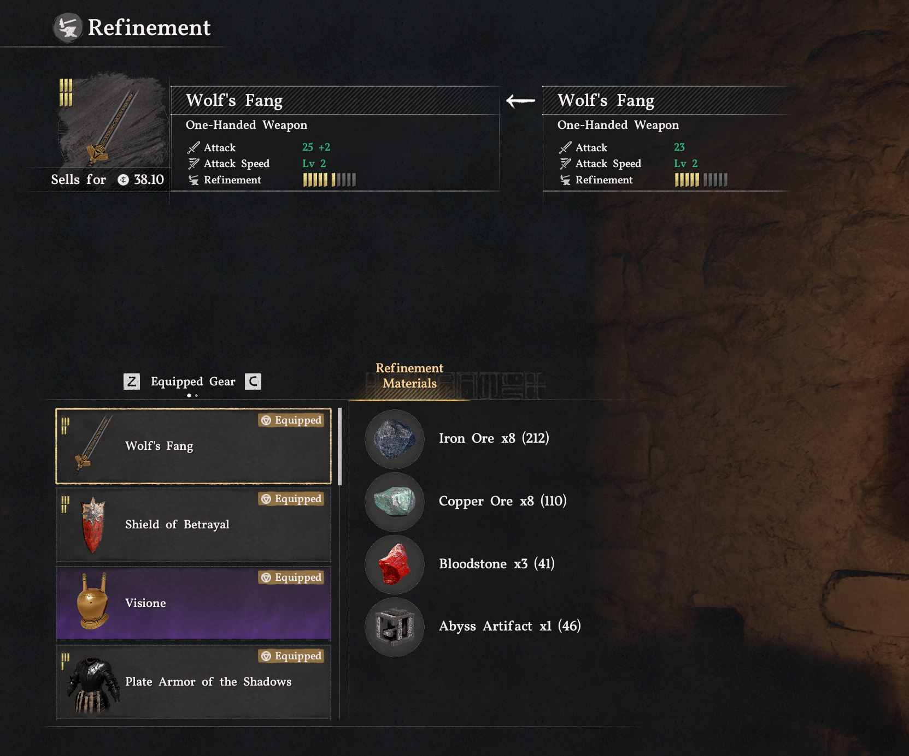
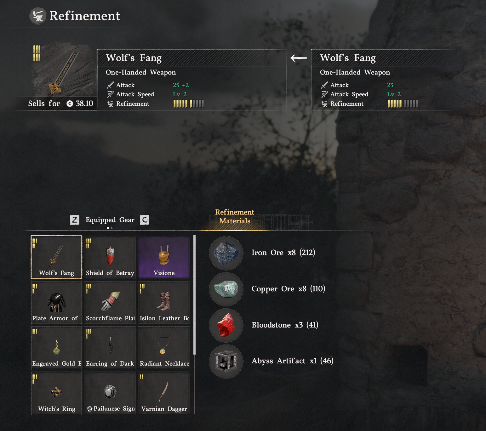
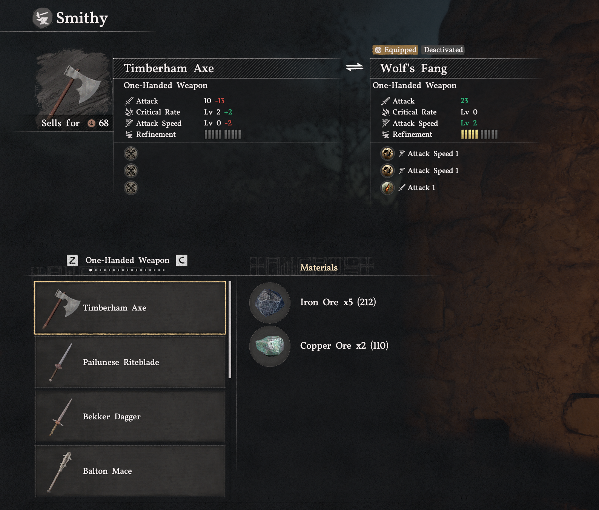
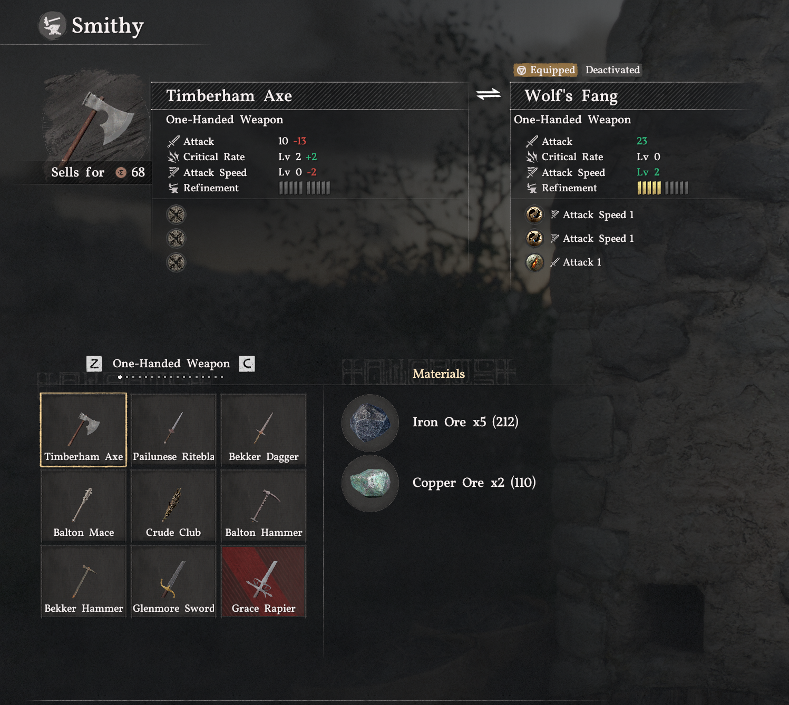
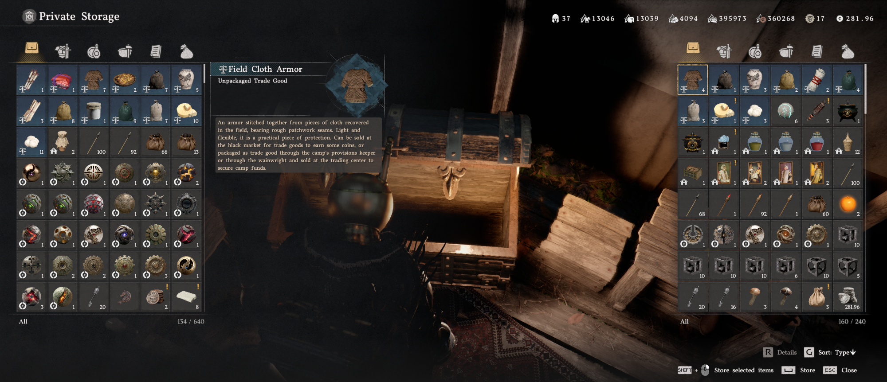
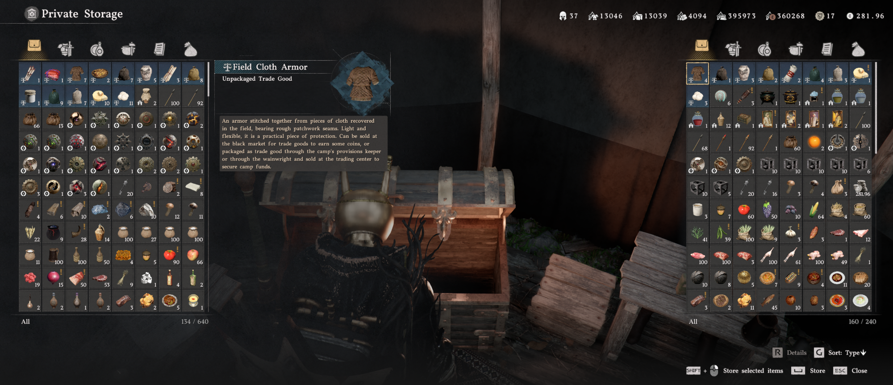
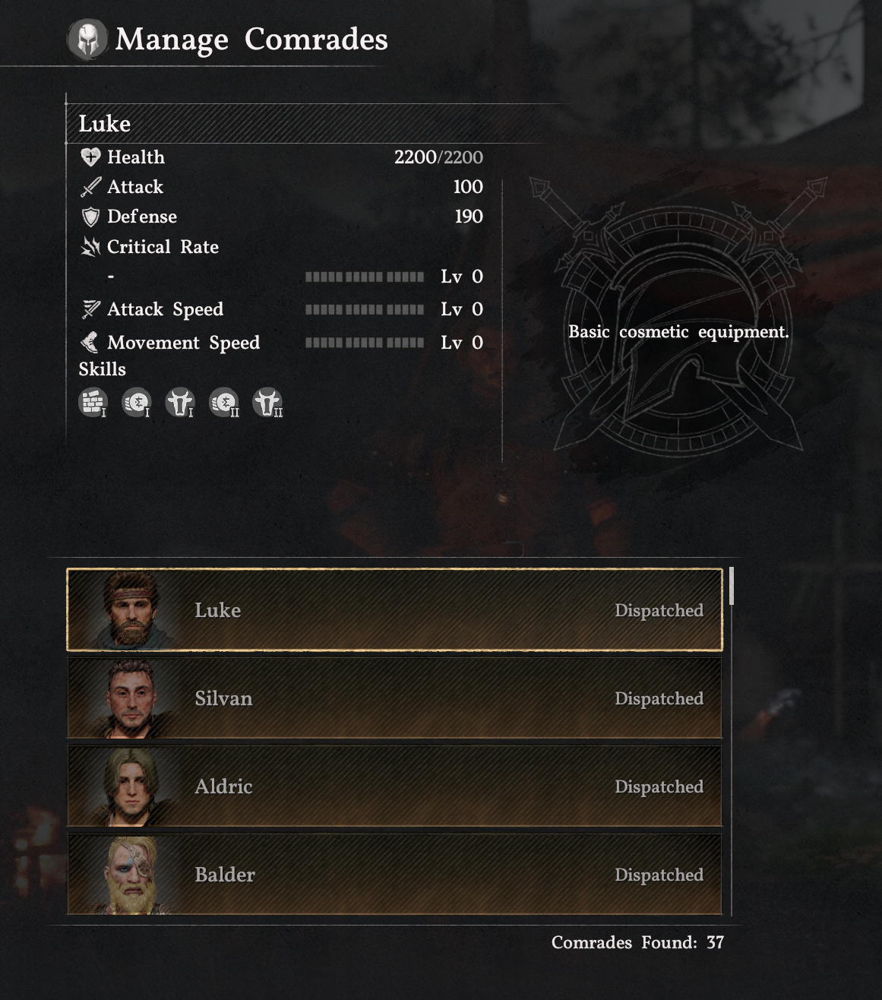
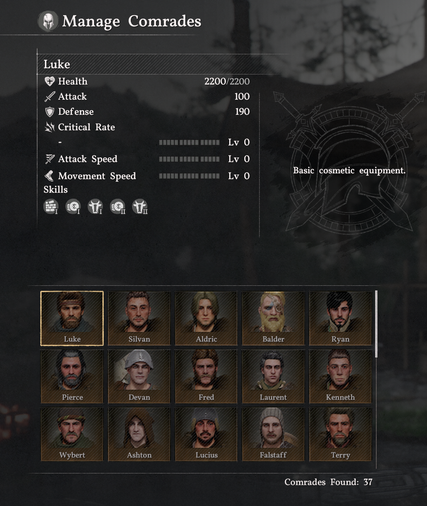
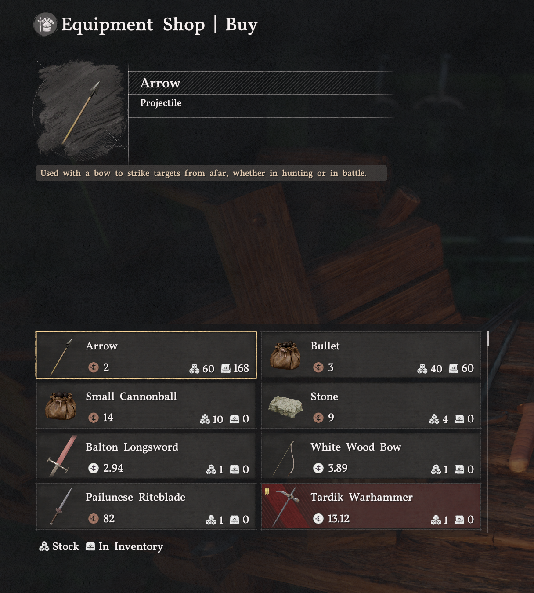
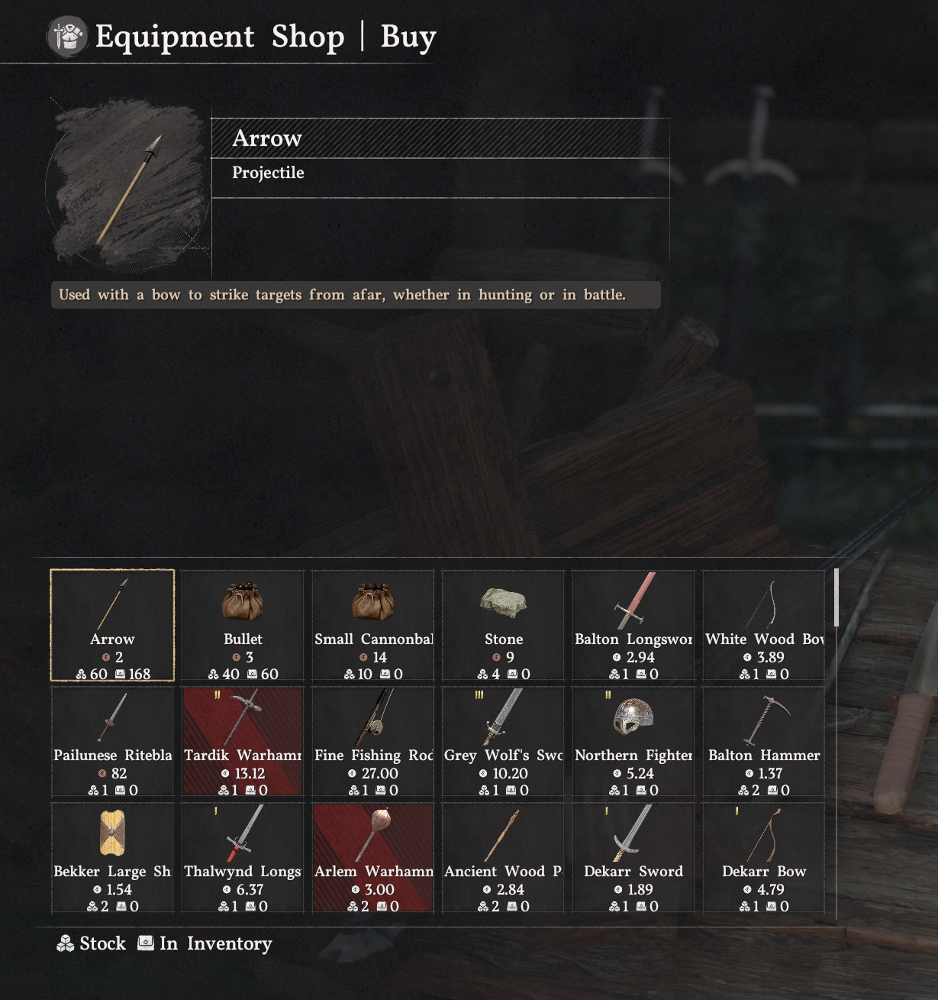

# Crimson Desert compact grids

NativeGrid makes Crimson Desert's inventory and NPC menus more compact, so you can see more items or comrades at once. It replaces several list views with grids while retaining the game's selection, scrolling, and action handlers.

## What changes

| Screen | Layout |
| --- | --- |
| Inventory and Private Storage | 8 columns, 11 visible rows |
| Shop Sell | 8 columns, 11 visible rows |
| Shop Buy | 6 columns, 3 visible rows |
| Refinement and Crafting | 3 columns, 4 visible rows |
| Extraction item selection | 3 columns, 4 visible rows |
| Manage Comrades | 5 columns, 3 visible rows with portraits and names |

The compact cards fit their artwork, labels, selection borders, and empty-slot backgrounds to the grid. Shop cards separate the price row from the aligned stock and owned counts. Refinement hides the redundant Equipped badge in the Equipped Gear tab. Gear cards retain their upgrade indicators and avoid duplicate item emblems.

The mod changes presentation. The game still handles purchases, crafting, refinement, extraction, and comrade actions. There is no toggle back to list view.

## Before and after

Expand a comparison to view the supplied in-game screenshots. Select an image to open it at full size.

Refinement

A three-column gear grid, with upgrade levels retained and redundant Equipped badges hidden.

<table>
<tr><th width="50%">Before</th><th width="50%">After</th></tr>
<tr>
<td valign="top"></td>
<td valign="top"></td>
</tr>
</table>

Crafting

Recipes use three columns while the selected item and materials remain in view.

<table>
<tr><th width="50%">Before</th><th width="50%">After</th></tr>
<tr>
<td valign="top"></td>
<td valign="top"></td>
</tr>
</table>

Inventory and storage

Both panels expand from 6 columns and 8 visible rows to 8 columns and 11 visible rows.

**Before**

**After**

Manage Comrades

Fifteen portrait-and-name cards replace four full-width list entries.

<table>
<tr><th width="50%">Before</th><th width="50%">After</th></tr>
<tr>
<td valign="top"></td>
<td valign="top"></td>
</tr>
</table>

NPC Buy Menu

Eighteen compact cards replace eight wide entries, with prices, stock, and owned counts beneath each item.

<table>
<tr><th width="50%">Before</th><th width="50%">After</th></tr>
<tr>
<td valign="top"></td>
<td valign="top"></td>
</tr>
</table>

## Current status and compatibility

**Revision 42 (`0.1.0-rc1`) has passed a user-reported basic game check on Steam build `26345091`.** Its deployed hash and active runtime were verified. Revision 41 remains the preserved rollback with the same layouts; revision 38 is the earlier checkpoint without the comrades grid. See the [release validation notes](docs/nexus-release.md#verification-and-remaining-steps) for scope.

The expanded layouts use experimental build flags. Some menu states and transaction flows still need testing. See the [changelog](CHANGELOG.md) for individual results and failed revisions.

Compatibility is tied to exact executable, index, and asset fingerprints. A game update needs an audit before a new package can be built or installed. Older compatibility records remain in the repository for previous builds.

## Build and install

This is a source repository. Extracted game assets and ready-to-install binaries are not included. Historical full-resource packages must remain local. The [Nexus release preparation guide](docs/nexus-release.md) describes the separate patch-based candidate, its portable ZIP, and remaining live checks.

1. Follow the [build guide](docs/build.md) to prepare dependencies, run checks, and choose the layouts to include.
2. Close Crimson Desert and keep DMM unmounted before installation.
3. Follow the [installation guide](docs/install.md) to verify and install the package. Keep its previous package and rollback files.

The ASI plugin replaces decoded UI resources in memory. It does not modify signed game archives, indexes, or saves. The installer manages `NativeGrid.asi`, `winmm.dll`, and `winmm.ini` in `bin64` and preserves rollback copies.

To manage revision 41 through DMM's ASI Mods library, use the [DMM export and migration guide](docs/dmm.md). Import and disable/re-enable deployment are verified with DMM 4.6.0. The plugin and shared loader remain unchanged. In-game testing after migration and coexistence with DMM's runtime remain pending.

## Development and documentation

Canonical source lives in `nativegrid/`; build and installation scripts live in `scripts/`. Changes use small commits, exact compatibility guards, and relevant fixture checks. Live UI confirmation is recorded separately from offline test results.

- [Changelog](CHANGELOG.md): concise revision history.
- [Grid troubleshooting](docs/grid-layout-troubleshooting.md): layout failures, their causes, and fixes.
- [Runtime and compatibility](docs/runtime.md): replacement hooks and native guards.
- [Repository workflow](AGENTS.md): contribution and publication rules.

## License

NativeGrid's original code and mod changes use the [MIT License](LICENSE). Retain the copyright and license notice when reusing them. Dependency licenses and game content remain separate; see [third-party notices](THIRD_PARTY.md). The license does not cover game assets shown in screenshots.
